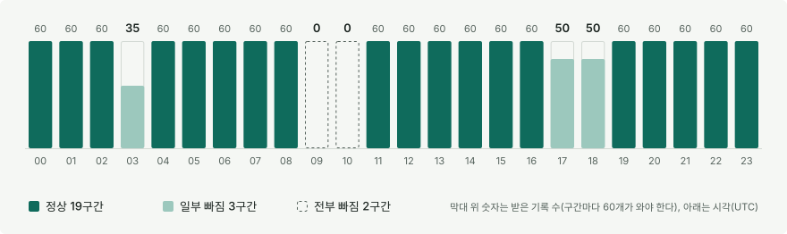

# busan-gaplog

설비 가동 기록에서 **빠진 구간까지** 솔라나에 남기는 시연입니다. 기록을 1시간 단위로 잘라 구간마다 지문과 받은 개수, 상태를 메모 거래로 적습니다. 원본은 체인 밖에 둡니다. 누구든 원본에서 지문을 다시 계산해 체인과 맞춰 볼 수 있습니다.

> 실제 설비 데이터가 아니라 모의 기록입니다. 솔라나 데브넷에서 돌렸습니다. 부산 블록체인 해커톤 2026 출품용 시연입니다.

<picture>
  <source media="(prefers-color-scheme: dark)" srcset="docs/windows-dark.svg">
  
</picture>

2026-11-20 하루치 모의 기록입니다. 통신이 세 번 끊겨 1,440개 중 1,275개만 들어왔습니다.

## 왜 빠진 구간을 적는가

기록이 비었을 때 보통은 그 자리를 그냥 건너뜁니다. 그러면 나중에 장부를 보는 사람은 설비가 멈췄던 것인지, 값이 지워진 것인지, 처음부터 안 들어온 것인지 구분할 수 없습니다. 이 시연은 비어 있다는 사실 자체를 그 시각에 기록으로 남깁니다. 정산은 온전한 구간만으로 하고, 빠진 구간은 보류로 따로 셉니다.

## 결과

| 항목 | 값 |
| --- | --- |
| 체인에 남긴 구간 요약 | 24건 (데브넷 메모 거래) |
| 원본과 체인 대조 | 일치 24, 불일치 0 |
| 정상 구간 | 19개, 합계 2,060.746 kWh (확정분) |
| 보류 구간 | 5개, 받은 값만 더하면 214.743 kWh |
| 원본 두 곳을 고친 파일로 대조 | 고친 2개 구간이 불일치로 나옴 |

기록에 쓴 계정은 [`CbixKLGu…BEWAJ`](https://explorer.solana.com/address/CbixKLGuTc3WBSWfbP7g5YrS5ZW7awJrgGNcsqJBEWAJ?cluster=devnet)입니다. 거래 서명 24개는 [`data/ledger.json`](data/ledger.json)에 있습니다.

## 체인에 남는 것

구간 하나가 거래 하나입니다. 메모는 173바이트 안팎의 JSON입니다. 아래는 03시 구간입니다. 60개가 와야 하는데 35개만 왔다고 적혀 있습니다. ([탐색기에서 보기](https://explorer.solana.com/tx/5o8o8AsoQHnEit5pXKGeCrZQwXF4wpAbzeHXHmgh6HCtozNnEwebW4dUVaX8yT16Lfe8mMJGD2sdxQp3GmfxhkmN?cluster=devnet))

```json
{"v":1,"dev":"MOCK-ESD-01","from":1795143600,"sec":3600,"exp":60,"got":35,"st":"PARTIAL","sum":74.252,"h":"33bffe795495061051e9549ecd7caf15f07ecda96ad22e5e2c4d6fb7b6897348"}
```

| 키 | 뜻 |
| --- | --- |
| `dev` | 설비 식별자 |
| `from`, `sec` | 구간 시작 시각(유닉스 초)과 길이 |
| `exp`, `got` | 받았어야 할 개수와 실제로 받은 개수 |
| `st` | `OK` 정상, `PARTIAL` 일부 빠짐, `MISSING` 전부 빠짐 |
| `sum` | 그 구간에 받은 값의 합(kWh) |
| `h` | 구간 원본의 SHA-256 지문 |

하나도 못 받은 구간도 거래를 남깁니다. [09시 구간](https://explorer.solana.com/tx/3WZ4NPrMZD7zpFzfwG4FUnHXqDkMk941SZ7ahgmXimdkQX6FSy1HaEyBNVnr1nNuZWhJFTJSkdVRtsJpWhZxWZYH?cluster=devnet)은 `got` 0, `st` `MISSING`입니다.

## 직접 돌려 보기

Node 22에서 확인했습니다.

```bash
npm ci
node verify.js                          # 저장소의 원본과 데브넷 기록을 대조
node verify.js data/raw-tampered.json   # 원본을 고친 파일로 대조하면 불일치가 나온다
```

처음부터 다시 만들려면 아래 순서입니다. 기록할 때는 데브넷 SOL이 든 키가 필요합니다. 키는 `.keys/`에 만들어지고 저장소에는 올리지 않습니다.

```bash
node gen.js      # 모의 기록 24시간 생성 → data/raw.json
node anchor.js   # 구간 요약 24건을 체인에 기록 → data/ledger.json
node verify.js   # 대조와 확정분, 보류분 합계
```

| 환경 변수 | 기본값 | 쓰임 |
| --- | --- | --- |
| `RPC` | 데브넷 공개 주소 | 접속할 노드 |
| `LEDGER` | `data/ledger.json` | 거래 서명을 적는 파일 |
| `PACE_MS` | 0 | 요청 사이 대기 시간. 공개 노드가 요청을 막으면 4000 정도로 둔다 |

대조 결과를 화면으로 보려면 [`view.html`](view.html)을 내려받아 브라우저로 엽니다. 파일 하나로 되어 있고 외부 자원을 불러오지 않습니다. 다시 만들 때는 아래처럼 합니다.

```bash
PACE_MS=4000 OUT=data/verify.json node verify.js   # 대조 결과를 파일로 남긴다
node build-view.js                                 # view.html 생성
```

네트워크 없이 보려면 `solana-test-validator --ledger test-ledger --reset`을 띄우고 `RPC=http://127.0.0.1:8899 LEDGER=data/ledger-local.json`으로 실행합니다.

## 파일

| 파일 | 하는 일 |
| --- | --- |
| `lib.js` | 구간 나누기, 지문 계산, 상태 판정 |
| `gen.js` | 통신 끊김 세 곳이 든 모의 기록 생성 |
| `anchor.js` | 구간 요약을 메모 거래로 기록. 끊겨도 이어서 기록 |
| `verify.js` | 체인의 메모를 읽어 원본과 대조 |
| `build-figure.js` | 위 그림을 `data/raw.json`에서 생성 |
| `build-view.js` | 구간별 대조 결과를 한 화면에 보여 주는 `view.html` 생성 |
| `DESIGN.md` | 그림과 화면에 쓰는 색, 글자, 모서리 값 |

## 한계

- 값은 모의 기록입니다. 실제 설비나 계량기에 붙여 본 적은 없습니다.
- 데브넷 기록이라 실제 가치와 연결돼 있지 않습니다. 데브넷이 초기화되면 거래가 사라질 수 있습니다.
- 지문은 원본이 바뀌지 않았다는 것만 보여 줍니다. 처음 들어온 값이 맞는 값인지는 계측 쪽에서 따로 보장해야 합니다.
- 설비 한 대, 하루치만 다뤘습니다.
